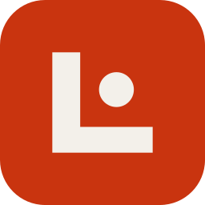

# PdfLens app icon



**Mark:** a white "L" (the corner of a page, and the L of Lens) with a white dot where the eye reads,
on a deep red tile. Flat shapes only, no gradients or text.

**Palette:** two colours.

| Colour | Hex | Used for |
|---|---|---|
| Deep red | `#c9340f` | the tile |
| Paper | `#f3f0ea` | the L and the dot |

**Tile:** `viewBox="0 0 100 100"`, a rounded square with `rx=22`; the mark sits at 68 % scale, offset 16.
Windows and Linux icons use the full tile. macOS icons put it on Apple's grid (an 824 px body centred
on a transparent 1024 px canvas). The 16 and 24 px sizes come from hand-fitted masters that sit on the
pixel grid.

**Provenance:** original artwork made for PdfLens by its maintainer. The file names keep the
`pdfcraft` prefix because the build, installer and packaging refer to them by those names.
Licence: [LICENSE.txt](LICENSE.txt) (`MIT OR Apache-2.0`, like the repo).

## Files

| File | What it is |
|---|---|
| `pdfcraft.svg` | the master vector; every PNG, `.ico` and `.icns` is rendered from it (except 16 and 24 px) |
| `pdfcraft-16.svg`, `pdfcraft-24.svg` | hand-fitted masters for the 16 and 24 px icons |
| `pdfcraft-small.svg` | a copy of the master, shown in this README |
| `pdfcraft-1024.png` | 1024 px on Apple's grid; also the runtime Dock icon on macOS |
| `pdfcraft.icns` | macOS icon (16–1024 px) |
| `pdfcraft.ico` | Windows icon (16–256 px), embedded in `pdfcraft.exe` by `apps/pdfcraft/build.rs` |
| `pdfcraft-document.svg` | Windows PDF file icon master: a Lucide document outline, red badge and outlined PDF lettering; no font dependency |
| `pdfcraft-document.ico` | Windows PDF file icon (16–256 px), embedded as resource 2 in `pdfcraft.exe` |
| `hicolor/<n>x<n>/apps/ai.storyteller.pdfcraft.png` | Linux hicolor theme, 16–512 px; the 256 px one is the runtime icon on Windows and Linux |
| `hicolor/scalable/apps/ai.storyteller.pdfcraft.svg` | Linux scalable icon (copy of the master) |

Where it shows: `apps/pdfcraft/src/main.rs` sets the window icon (Dock, taskbar, Alt-Tab, launcher) and the
Wayland app id `ai.storyteller.pdfcraft`; `packaging/linux/ai.storyteller.pdfcraft.desktop` names the
hicolor icon.

Windows PDF files use resource 2 (`"pdfcraft.exe",-2`) when PdfCraft is chosen as the default
reader; the app keeps resource 1. The document outline is adapted from Lucide `file-text`
1.49.0 (ISC); its badge and outlined lettering are original (`MIT OR Apache-2.0`), covered by
[LICENSE-document.txt](LICENSE-document.txt). Both icons are embedded, requiring no runtime
sidecar. This provides a file type icon; first-page thumbnails still need a thumbnail provider.

## Regenerate

```sh
packaging/icons.sh        # needs resvg and python3; iconutil (macOS) or Pillow for the .icns
cargo xtask assets        # then update the sha256 values in ATTRIBUTION.toml and run with --write
```
